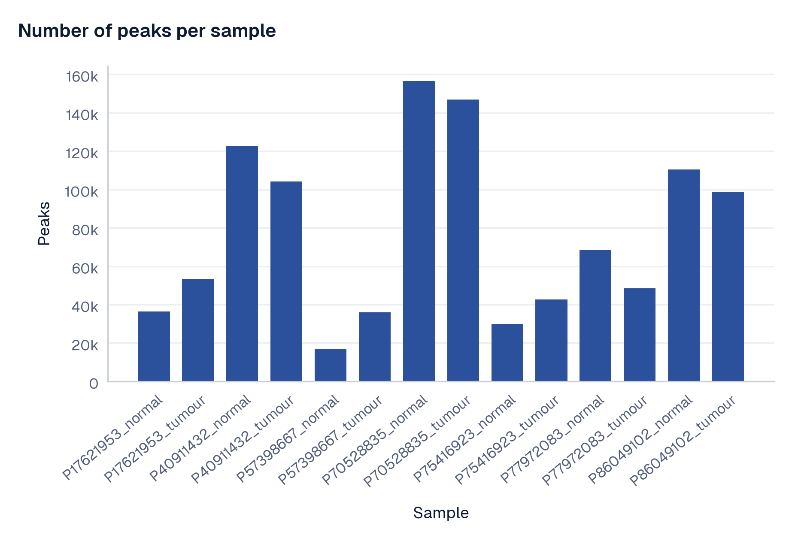
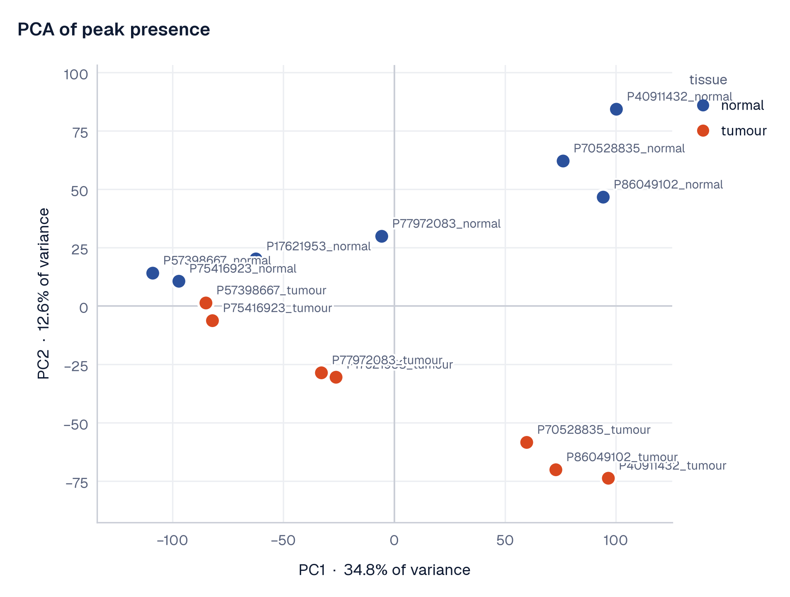
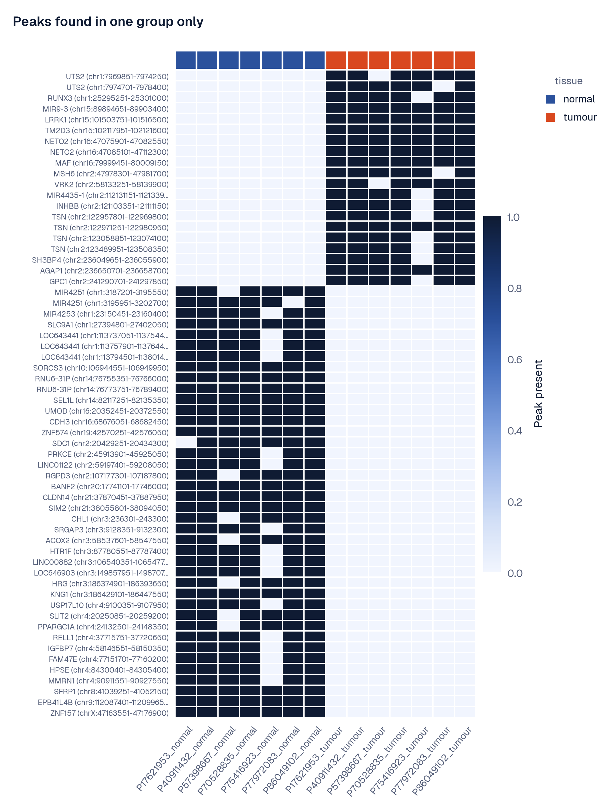
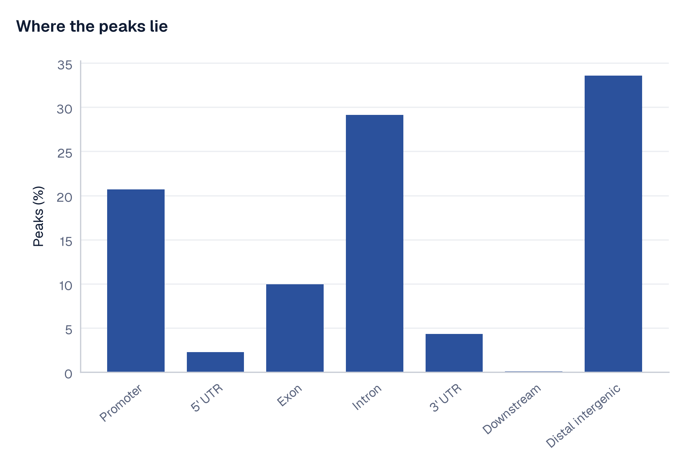
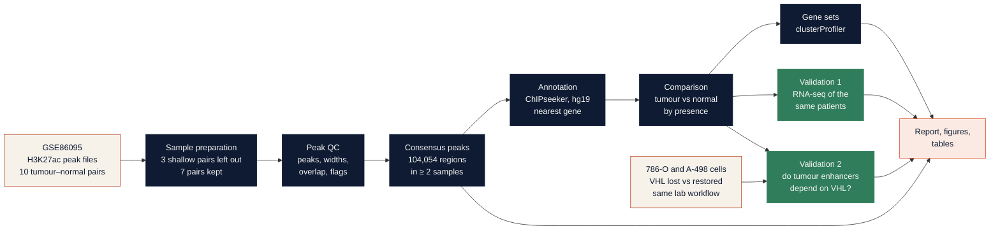
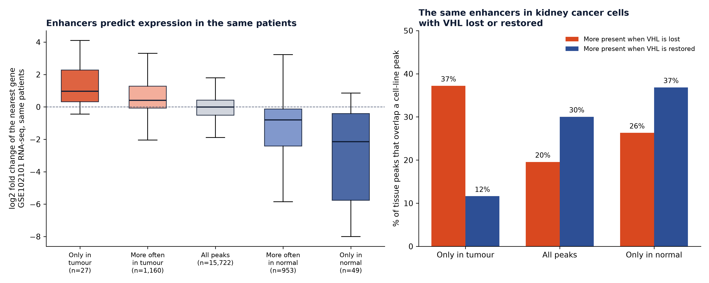

<p align="center"></p>

# Active enhancers in kidney cancer: a ChIP-seq peak analysis in the LSMA Analysis Lab

**Which regulatory switches of the genome turn on and off when kidney tissue becomes clear cell renal cell carcinoma, and do they explain which genes change?**

This repository is a worked example from the **LSMA Analysis Lab**, the analysis platform of the [London School of Multiomics & AI](https://lsma.co.uk). The full analysis was run in the lab, without writing code: upload of published peak files, peak quality control, consensus peaks, annotation to genes, comparison of tumour and normal, and gene-set analysis. The report, figures and tables it produced are here, with two validation checks.

| | |
|---|---|
| **Data** | GSE86095 (Yao et al., *Cancer Discovery* 2017): H3K27ac ChIP-seq peaks, the mark of **active enhancers and promoters** |
| **Samples** | Clear cell kidney tumour and adjacent normal kidney from the same patients: 10 pairs published, **7 pairs analysed** (3 left out for very low peak numbers) |
| **Comparison** | tumour vs normal, by presence of peaks |
| **Lab module** | ChIP-seq and ATAC-seq peaks (workflow version 1.0.0), genome hg19 |
| **Lab run time** | **2 min 15 s** for the whole analysis (upload of 20 peak files: 2 s) |
| **Validation** | RNA-seq of the **same patients** (GSE102101), and the same mark in kidney cancer cell lines with **VHL lost or restored** (lab run: **1 min 40 s**) |
| **Result** | Genes beside tumour-only enhancers are switched on in the same patients' tumours; tumour-only enhancers lean strongly towards being active when VHL is lost (odds ratio 4.9) |

---

## Biological question and aim

**Question.** Genes are switched on by **enhancers**, stretches of DNA that can sit far from the genes they control. In clear cell kidney cancer, the loss of the *VHL* gene is thought to activate new enhancers. Which enhancers are active only in tumours or only in normal kidney, and do they explain the genes that change?

**Hypothesis.**
- Tumours should gain active enhancers near genes they switch on and lose enhancers near the kidney genes they switch off.
- Part of the gain should depend directly on the loss of VHL.

**Aims**
1. Map active regulatory regions (H3K27ac peaks) in 7 tumour–normal pairs and find the regions active in only one of the two.
2. Annotate them to their nearest genes and gene sets.
3. Check them against RNA-seq of the **same patients' tumours**.
4. Check them against an experiment in kidney cancer cells where **VHL is put back**.
5. Show each step as it is run in the LSMA Analysis Lab, so a student can repeat it.

---

## Background: enhancers, H3K27ac and peaks

DNA is wrapped around histone proteins, and chemical tags on those histones mark what each stretch of DNA is doing. **H3K27ac** (acetylation of lysine 27 on histone H3) marks **active enhancers and active promoters**: the switches that are on in a given cell.

**ChIP-seq** (chromatin immunoprecipitation followed by sequencing) pulls down the DNA carrying a mark and sequences it. Where many reads pile up, a **peak** is called: a region where the mark is present. Comparing peaks between tumour and normal tissue shows which switches the cancer has turned on or off. Peaks can lie far from genes, so each is linked to its nearest gene. That's a reasonable guess, but not proof of which gene it controls.

**In clear cell kidney cancer**, losing *VHL* keeps the hypoxia factors HIF-1α and HIF-2α active. The study these data come from showed that VHL loss also **rewires the cell's enhancers**, activating enhancers of oncogenes. That's why the same study re-expressed VHL in kidney cancer cell lines: to see which enhancers depend on it.

---

## Key findings

1. **104,054 active regions** form the consensus across the 14 samples (present in at least 2 samples). 21% lie at promoters and 34% far from any gene.
2. **59 regions are active in the tumours only, and 103 in normal kidney only.** The rule is strict: present in at least 75% of one group's samples and absent from every sample of the other (Figure 1). Using a looser rule (the share of samples with a peak differs by at least 0.5 between the groups), 2,332 regions are more often active in tumour and 2,433 more often in normal kidney.
3. **Tumour-only enhancers sit near genes that are switched on in ccRCC.** The list includes *UTS2*, *RUNX3*, *NETO2*, *INHBB*, *MAF*, *PCSK6*, *VWF* (blood vessels), *SLC7A5* (an amino-acid transporter) and the cell-division gene *MKI67*. Most of them are strongly higher in the same patients' tumours (see Validation).
4. **Normal-only enhancers sit near the kidney's own genes.**
   - *UMOD* and *KNG1* are among the genes most strongly lost in our [bulk RNA-seq analysis](https://github.com/MultiOmics-Intelligence/lsma-lab-bulk-rnaseq-kidney-cancer-tcga-kirc).
   - The list also includes *CLDN14*, *SFRP1*, *PPARGC1A* (mitochondrial biogenesis, consistent with the loss of oxidative phosphorylation seen in bulk), *SLC9A1* and *HRG*.
5. **Gene sets.** The genes beside lost enhancers point to epithelial and wound-healing programmes (cell junctions, epithelial differentiation; Figure 6): the tubule epithelium's identity fading. The gained list is too short for gene-set tests.

Evidence labels from the lab: the comparison is **descriptive** (presence and absence, no p-values; see Limitations). Gene readings are *biological interpretation*.

---

## Quality control and PCA

ChIP-seq peak files differ a great deal in quality: the antibody, the amount of tissue and the sequencing depth all change how many peaks are called.

**Peaks per sample** vary a great deal (Figure QC1): from 1,627 to 156,458 in the published files.
- **Three pairs left out.** They contain a sample with fewer than 6,000 peaks, against a median of about 40,000: patients 12364284 and 74575859 (very shallow normal samples) and 20431713 (shallow tumour).
- **Why that matters:** in a presence comparison, a shallow normal sample makes many tumour regions look "tumour-only" simply because the normal sample missed them.
- The lab flagged the same samples on upload. They were removed in the sample preparation step with the reason recorded, as students are taught to do.

**Among the 7 pairs kept:**
- **Depth differs by patient, not tissue.** Peak numbers range from 16,848 to 156,460, and each patient's tumour and normal samples are similar to each other.
- **Two pairs flagged, but kept.** Patients 57398667 and 75416923 overlap less with the other samples. Their narrower peaks (about 1 kb, against 2–3 kb for the others; Figure QC2) suggest different processing. They were kept, because the paired comparison is between a tumour and its own normal.

### PCA of peak presence
The lab's PCA is built on where each sample has peaks (Figure QC6). It shows something worth learning:
- **PC1 (35%) separates patients, not tissue.** Each tumour sits level with its own normal, because data depth and processing differ from patient to patient.
- **PC2 (13%) separates tumour from normal**, consistently in every pair.

This is why the comparison is paired: a pooled comparison would be dominated by differences between patients.

| | |
|---|---|
|  **QC1.** Peaks per sample. |  **QC6.** PCA of peak presence: PC1 follows patient, PC2 follows tissue. |

Peak widths (QC2), overlap between samples (QC3), how many samples share each region (QC4) and sample similarity (QC5) are in [`figures/`](figures).

---

## Figures

| | |
|---|---|
|  **Figure 1.** Regions active in one group only: tumour-only enhancers (top) and normal-only enhancers (bottom), with their nearest genes. |  **Figure 4.** Where the active regions lie: promoters, introns, distal regions. |

All figures are in [`figures/`](figures), as PNG (300 dpi) and vector PDF:

| File | What it shows |
|---|---|
| 01 | Regions active in one group only |
| 02 | Peak classes |
| 03 | Where the differing peaks lie |
| 04 | Where all peaks lie |
| 05 | Distance to the nearest gene start |
| 06 | GO gene sets |
| qc-pca-* | Quality control and PCA |

## The full report

The lab's own report covers every stage: what was done, why, the checks, the results and their limits. It's available as a [**PDF**](report/LSMA-Analysis-Lab-report-kidney-cancer-enhancers.pdf) or as [**HTML**](report/LSMA-Analysis-Lab-report-kidney-cancer-enhancers.html) (download it and open it in a browser for the interactive version).

## Summary tables ([`results/`](results))

| File | Contents |
|---|---|
| `enhancers_only_in_tumour_or_normal.tsv` | The 162 regions active in one group only: position, nearest gene, feature, distance to the gene start, and samples with a peak in each group |
| `peaks_per_sample.tsv` | Peak numbers per sample |
| `sample_qc.tsv` | Peak quality per sample: peaks, width, overlap with the others, flags |
| `gene_sets.tsv` | Gene-set results for genes near gained and lost regions |

---

## Workflow



## How it was done

Every step below is a stage in the LSMA Analysis Lab, run with the settings in [`settings/analysis-settings.json`](settings/analysis-settings.json).

1. **Data.**
   - The authors' published H3K27ac peak files (CCAT peaks, hg19) for 10 tumour–normal pairs were downloaded from GEO.
   - They were uploaded into the lab as peak files with a sample sheet (patient, tissue).
2. **Sample preparation.** Tumour against normal as the reference, paired by patient. Three pairs with a very shallow sample were left out, with the reason recorded.
3. **Peak QC.** Peaks per sample, peak widths, and the overlap between every pair of samples (share of base pairs in common). Samples that overlap little with the others are flagged.
4. **Consensus peaks.** Overlapping peaks of all samples were merged, and regions with a peak in at least 2 samples were kept: 104,054 of 178,507.
5. **Annotation.** Each region was assigned its feature (promoter: ±3 kb of a gene start; intron; distal) and its nearest gene, with ChIPseeker and the UCSC hg19 gene model.
6. **Comparison.**
   - A region is "only in tumour" when it has a peak in at least 75% of tumours and in no normal sample, and the reverse for "only in normal".
   - Peak files hold no read counts, so this comparison is by presence and absence, without p-values.
7. **Gene sets.** Over-representation analysis (clusterProfiler) of the genes whose start site lies within 50 kb of a differing region, against MSigDB Hallmark and GO.

**Software:** R 4.5.2 and Bioconductor 3.21, with GenomicRanges, ChIPseeker, TxDb.Hsapiens.UCSC.hg19.knownGene and clusterProfiler, in the versions listed in the settings file.

## The mathematics behind the methods

The formulas below are the ones the lab's code runs. Peak files hold no read counts, so every measure is built on where peaks are, not on how strong they are.

**Overlap between two samples (Jaccard index)**

$$
J(A, B) = \frac{|A \cap B|}{|A \cup B|}
$$

A and B are the stretches of genome covered by the peaks of two samples, and |·| counts base pairs. J is 1 when the two samples have peaks in exactly the same places and 0 when they share none. This is the overlap shown in the sample-overlap heatmap.

**Sample flags**

$$
n_s < 0.25 \cdot \mathrm{median}(n) \quad \text{or} \quad \bar{J}_s < \mathrm{median}(\bar{J}) - 3 \cdot \mathrm{MAD}(\bar{J})
$$

Here $n_s$ is the number of peaks of sample s, and $\bar J_s$ is its mean Jaccard index with every other sample. MAD is the median absolute deviation, scaled by 1.4826 so that it matches the standard deviation for normal data; an overlap flag also needs the sample to lie at least 0.05 below the median. A flag is a prompt to look, not an automatic removal.

**Consensus regions and the presence matrix**

$$
O_{rs} = \mathbf{1}\left[\text{sample } s \text{ has a peak overlapping region } r\right], \qquad \text{keep } r \text{ if } \sum_{s} O_{rs} \ge 2
$$

The peaks of all samples are pooled, and peaks that overlap or touch are merged into one region r. The matrix O holds 1 when a sample has a peak in a region and 0 when it has none. Regions with a peak in at least 2 samples were kept: 104,054 of 178,507.

**Tumour against normal by presence**

$$
f_T(r) = \frac{1}{n_T} \sum_{s \in T} O_{rs}, \qquad \text{only in tumour: } f_T(r) \ge 0.75 \ \text{and} \ f_N(r) = 0
$$

$f_T(r)$ is the share of the $n_T$ tumour samples with a peak in region r, and $f_N(r)$ the same share for the normal samples. "Only in normal" is the mirror rule. The looser rule in the Key findings uses the difference between the two shares, at least 0.5. These are descriptions of the peak calls; no p-value is attached.

**PCA of peak presence**

$$
\tilde{O}_{sr} = O_{sr} - \bar{O}_r, \qquad \tilde{O} = U \Sigma V^{\top}, \qquad \text{share of variance}_k = \frac{\sigma_k^2}{\sum_j \sigma_j^2}
$$

Each sample is a row of 0s and 1s over the regions that are not shared by all samples, centred on each region's mean but not scaled. The singular value decomposition gives the principal components; the sample scores are the rows of UΣ and $\sigma_k$ is the k-th singular value. This is where the 35% (PC1, patient) and 13% (PC2, tissue) come from.

**Assigning regions to genes**

$$
\text{promoter: } |d_r| \le 3 \text{ kb}, \qquad \text{gene used for gene sets: } |d_r| \le 50 \text{ kb}
$$

$d_r$ is the distance from region r to the nearest transcription start site in the UCSC hg19 gene model, found by ChIPseeker; it takes the gene's strand into account and is negative when the region lies upstream. Regions within 3 kb either side of a start site are called promoters, and the nearest gene is used for the gene-set step only when it is within 50 kb.

**Gene-set over-representation (hypergeometric test)**

$$
p = \sum_{j=k}^{\min(n,K)} \frac{\binom{K}{j}\binom{N-K}{n-j}}{\binom{N}{n}}, \qquad \text{fold enrichment} = \frac{k/n}{K/N}
$$

N is the number of background genes (genes within 50 kb of any compared region that belong to at least one set), K of them are in a given Hallmark or GO set, n is the number of genes near the tumour-only (or normal-only) regions and k of those are in the set. The p-value is the chance of k or more by random picking, and sets of 10 to 500 genes were tested.

**Benjamini–Hochberg adjustment**

$$
p^{\text{adj}}_{(i)} = \min_{j \ge i} \ \min\left(1,\ \frac{m \cdot p_{(j)}}{j}\right)
$$

The m p-values of one test series are sorted, $p_{(1)} \le \dots \le p_{(m)}$, and each is scaled by m divided by its rank. Keeping sets with an adjusted p below 0.05 limits the expected share of false discoveries among them to 5%.

---

## Validation

### 1. RNA-seq of the same patients
The same 10 patients' tumours and normal kidney were RNA-sequenced by the same study (GSE102101). We analysed that RNA in the lab to validate the [bulk RNA-seq analysis](https://github.com/MultiOmics-Intelligence/lsma-lab-bulk-rnaseq-kidney-cancer-tcga-kirc). For the genes nearest to each group of regions (within 50 kb), their expression change in those patients was compared:

| Genes beside… | Genes | Median log2 change (RNA) | Higher in tumour | Strongly higher | Strongly lower |
|---|---|---|---|---|---|
| **Regions only in tumour** | 27 | **+0.96** | **78%** | 48% | **0%** |
| Regions more often in tumour | 1,160 | +0.41 | 70% | 31% | 7% |
| All genes with a region | 15,722 | 0.00 | 50% | 11% | 15% |
| Regions more often in normal | 953 | −0.81 | 19% | 4% | 45% |
| **Regions only in normal** | 49 | **−2.14** | 12% | **0%** | **71%** |

*"Strongly" means at least two-fold, adjusted p < 0.05. The same pattern holds in the 24 TCGA patients of the bulk analysis; see [`validation/expression_near_differing_enhancers.tsv`](validation/expression_near_differing_enhancers.tsv).*

Gained enhancers sit beside genes that are switched on, lost enhancers beside genes that are switched off, and the more specific the region, the stronger the effect (Figure V1, left).

**Verdict: confirmed.**

### 2. Kidney cancer cells with VHL lost or restored
Two ccRCC cell lines that have lost VHL (786-O and A-498) carry either an empty vector or a working copy of *VHL* (2 replicates each). Their H3K27ac peaks went through the same lab workflow (lab run time **1 min 40 s**), comparing VHL lost with VHL restored and adjusting for cell line. 476 regions were active only with VHL lost and 761 only with VHL restored.

Each tumour or normal region was then looked up in the cell lines (Figure V1, right):
- **Tumour-only regions:** 73% are also active regions in the cell lines (against 49% of all regions). Among those that differ in the cells, they lean strongly towards being more active **when VHL is lost**: 37% are more active with VHL lost and 12% with VHL restored, against 20% and 30% for all regions (odds ratio 4.9, Fisher's exact test p = 0.001).
- **Normal-only regions** lean the other way: they're more often active with VHL restored (37% vs 26%).
- **The broader groups** ("more often in tumour or normal") show no clear difference in the cell lines.

**Verdict: partial support.**
- **What holds:** the most tumour-specific enhancers depend on VHL loss, as Yao et al. proposed.
- **What doesn't:** most of the broader difference between tumour and normal tissue is not reproduced in VHL-restored cells. That's expected, because tissue differences also reflect **which cells are present** (normal kidney is mostly tubule epithelium; a tumour is full of immune and blood-vessel cells, as our [single-cell analysis](https://github.com/MultiOmics-Intelligence/lsma-lab-single-cell-kidney-cancer-ccrcc) shows). A cell line in a dish shows only the part of the change that is driven by VHL inside the cancer cell.
- **The cell-line replicates are uneven:** replicates overlap no more with each other than with the other condition. That weakens this check.



**Figure V1.**
- **Left:** expression change, in the same patients, of the genes beside each group of regions.
- **Right:** how the tumour-only and normal-only regions behave in cells with VHL lost or restored.

All validation files, including the lab's report for the cell-line run, are in [`validation/`](validation).

---

## Limitations

- **Presence and absence only, no p-values.**
  - The published files are peak calls without read counts, so the lab compares where peaks are, not how strong they are.
  - A peak can be "absent" simply because a sample was sequenced less deeply.
  - A statistical test needs reads counted in the consensus regions (for example with DiffBind or featureCounts), which the lab supports as a count table.
- **Uneven data.** Peak numbers and widths differ greatly between patients; three pairs were left out and two kept despite flags. The paired design and the strict rule (absent in *every* sample of the other group) limit the effect.
- **The nearest gene is a guess.** Enhancers can act on genes far away; linking each region to its nearest gene is a convention.
- **Tissue is a mixture of cells.** Some differences reflect cell composition rather than changes within cancer cells (see Validation 2).
- **A teaching example, not clinical advice.** These results are for education and must not be used to diagnose or treat anyone.

---

## Repository structure

```
lsma-lab-chip-seq-kidney-cancer-enhancers/
├── README.md                  this case study
├── LICENSE                    CC BY 4.0
├── assets/
│   └── lsma-lab-kidney-enhancers-banner.svg      animated banner
├── report/                    the LSMA Analysis Lab's full report of the tissue run
│   ├── LSMA-Analysis-Lab-report-kidney-cancer-enhancers.pdf
│   └── LSMA-Analysis-Lab-report-kidney-cancer-enhancers.html
├── figures/                   key figures, PNG (300 dpi) and vector PDF
│   ├── 01-differential-specific_peaks_heatmap ... 06-enrichment-gene_sets_go_bp
│   └── qc-pca-*                                 quality control and PCA of peak presence
├── results/                   summary tables (tab-separated)
│   ├── enhancers_only_in_tumour_or_normal.tsv
│   ├── peaks_per_sample.tsv
│   ├── sample_qc.tsv
│   └── gene_sets.tsv
├── validation/                same-patient RNA-seq and the VHL cell-line experiment
│   ├── validation-enhancers-expression-and-vhl.png / .pdf
│   ├── expression_near_differing_enhancers.tsv
│   ├── vhl_cell_line_comparison.tsv
│   ├── tissue_peaks_with_cell_line_change.tsv.gz
│   ├── cell_lines_enhancers_only_with_VHL_lost_or_restored.tsv
│   └── LSMA-Analysis-Lab-report-cell-lines-VHL.pdf
└── settings/
    └── analysis-settings.json           parameters, software versions, the excluded pairs and why
```

## Why we share this analysis

This is one of a series of worked examples from the **LSMA Analysis Lab**, published openly for five reasons:

- **To show what the lab does, on real data.** Each repository takes one public dataset through one lab module, from import to report, and shows every step, figure and setting. Nothing is hidden or polished after the fact: the report here is the one the lab produced.
- **To teach a complete analysis, not just a result.** Students see the parts that are usually skipped: quality control, the choice of statistics, an independent validation, and an honest list of limitations.
- **To earn trust by checking known biology first.** These analyses deliberately reproduce findings that are already well established, such as the hypoxia programme and the Warburg switch in kidney cancer. A method that gets the known answers right can be trusted with new questions.
- **To keep testing our own tools.** Every example is a real-world test of the lab. Running public data from start to finish shows what works and what needs fixing, and the fixes go back into the lab for every student. Improvements from this series so far: a more reliable import from NCBI GEO, automatic choice of the right cell-type markers for each tissue in single-cell analysis, and removal of sex-chromosome probes and a more robust DIABLO model in multi-omics.
- **To make the work open and repeatable.** The data are public, every parameter and software version is listed, and diploma students can repeat the same analysis in the lab themselves.

The series follows one cancer, clear cell kidney cancer, through every layer: genes, single cells, DNA methylation, enhancers, mutations, proteins, metabolites and lipids, all of them together in the [multi-omics analysis](https://github.com/MultiOmics-Intelligence/lsma-lab-multi-omics-kidney-cancer-tcga-kirc), and predictions from tumour RNA in the [machine learning analysis](https://github.com/MultiOmics-Intelligence/lsma-lab-machine-learning-kidney-cancer-tcga-kirc). Each repository links to the others.

These examples are for education and must not be used for medical decisions.

## Data source and credits

- **Data:** Yao X, Tan J, Lim KJ, et al. VHL deficiency drives enhancer activation of oncogenes in clear cell renal cell carcinoma. *Cancer Discovery* 2017;7:1284–1305 (PMID 28893800).
  - Peak files from [GSE86095](https://www.ncbi.nlm.nih.gov/geo/query/acc.cgi?acc=GSE86095).
  - RNA-seq of the same patients from [GSE102101](https://www.ncbi.nlm.nih.gov/geo/query/acc.cgi?acc=GSE102101).
  - No raw data are copied into this repository.
- **Methods:**
  - Yu, Wang & He, *Bioinformatics* 2015 (ChIPseeker)
  - Lawrence et al., *PLoS Computational Biology* 2013 (GenomicRanges)
  - Wu et al., *The Innovation* 2021 (clusterProfiler)
  - Xu et al., *Bioinformatics* 2010 (CCAT, used by the authors to call the peaks)
- **Companion analyses:**
  - [bulk RNA-seq](https://github.com/MultiOmics-Intelligence/lsma-lab-bulk-rnaseq-kidney-cancer-tcga-kirc)
  - [single-cell RNA-seq](https://github.com/MultiOmics-Intelligence/lsma-lab-single-cell-kidney-cancer-ccrcc)
  - [DNA methylation](https://github.com/MultiOmics-Intelligence/lsma-lab-dna-methylation-kidney-cancer-tcga-kirc)
  - [somatic mutations and copy number](https://github.com/MultiOmics-Intelligence/lsma-lab-somatic-mutations-kidney-cancer-tcga-kirc)
  - [proteomics](https://github.com/MultiOmics-Intelligence/lsma-lab-proteomics-kidney-cancer-cptac)
  - [metabolomics](https://github.com/MultiOmics-Intelligence/lsma-lab-metabolomics-kidney-cancer)
  - [lipidomics](https://github.com/MultiOmics-Intelligence/lsma-lab-lipidomics-kidney-cancer)
  - [multi-omics](https://github.com/MultiOmics-Intelligence/lsma-lab-multi-omics-kidney-cancer-tcga-kirc)
  - [machine learning](https://github.com/MultiOmics-Intelligence/lsma-lab-machine-learning-kidney-cancer-tcga-kirc)

## Run it yourself

Diploma students of the London School of Multiomics & AI can repeat this analysis in the **LSMA Analysis Lab**:
1. Upload the peak files of GSE86095 with a sample sheet as **ChIP-seq and ATAC-seq peaks**.
2. Choose genome **hg19**.
3. In sample preparation, leave out the three shallow pairs.
4. Run the workflow.

Find out more about the diplomas at [lsma.co.uk](https://lsma.co.uk).

## Licence

The text, figures and tables in this repository are shared under [Creative Commons Attribution 4.0 (CC BY 4.0)](https://creativecommons.org/licenses/by/4.0/): you may reuse them with credit to the London School of Multiomics & AI. The underlying data remain available from NCBI GEO, with credit to the original authors.

---

**Dr. Anas Alzaeem**, Academic Director, London School of Multiomics & AI


